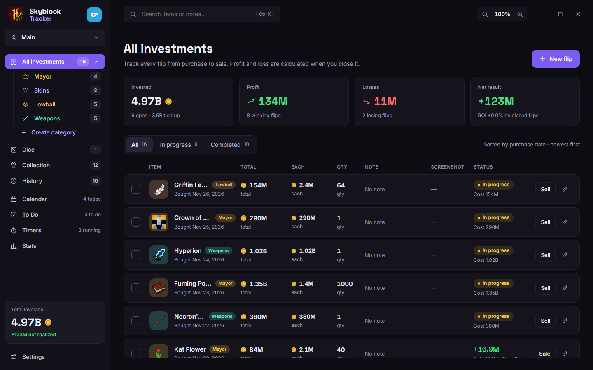
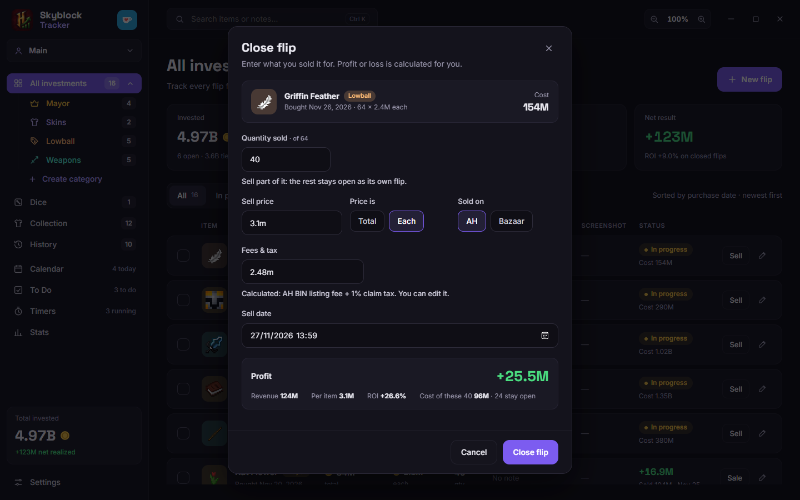
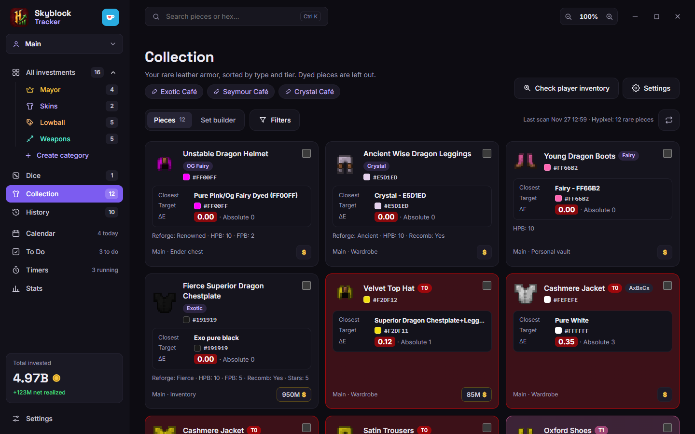
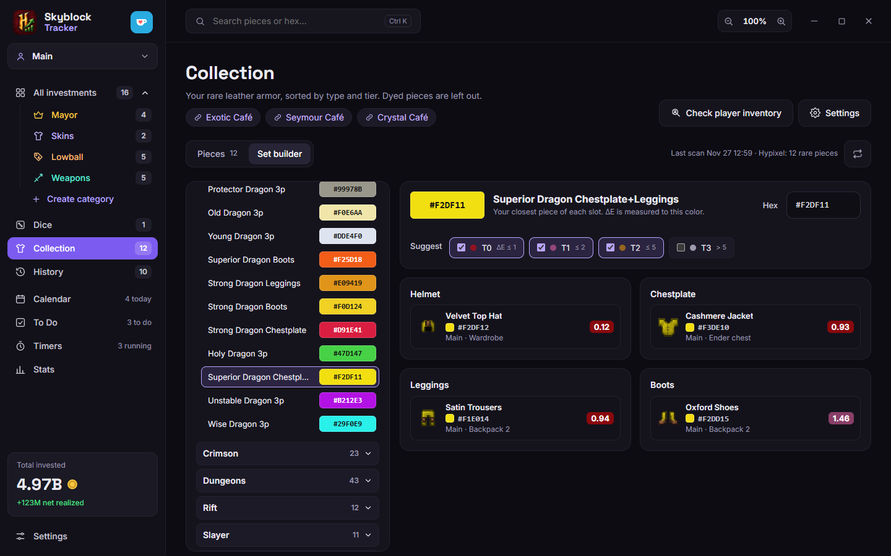
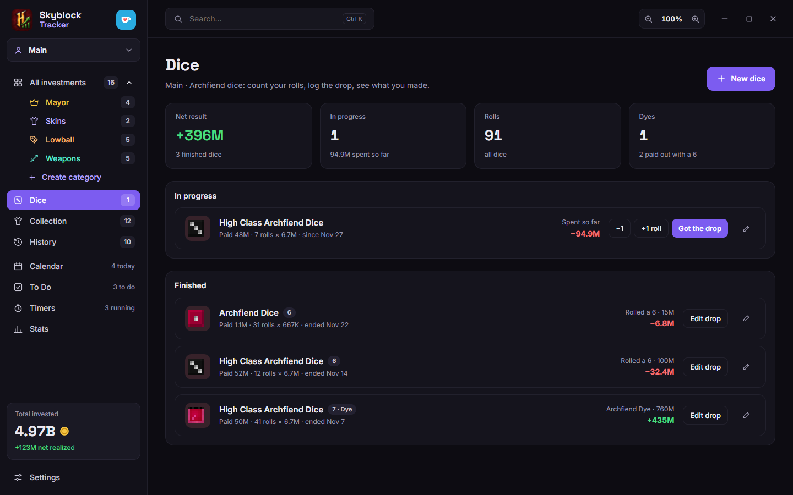
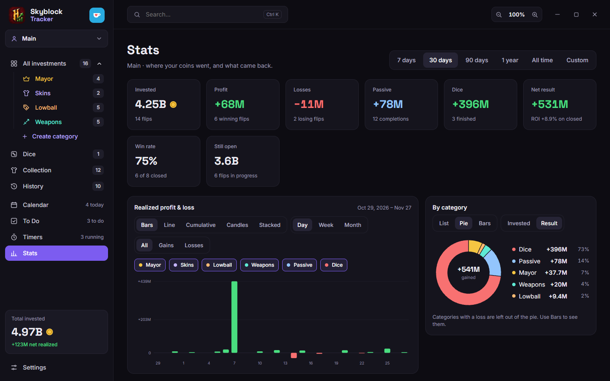
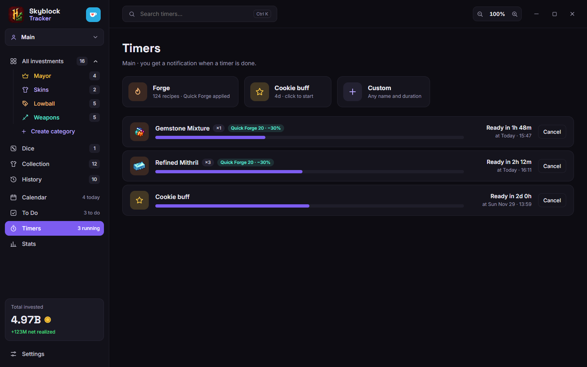
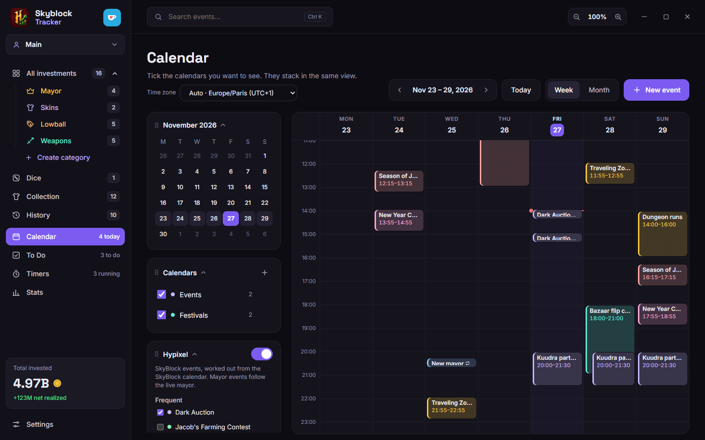
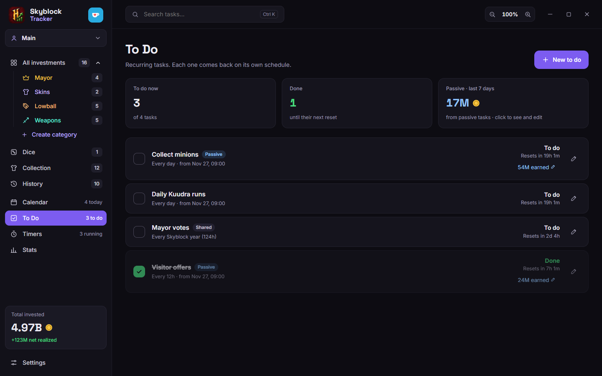

<p align="center">
  
</p>

<h1 align="center">Skyblock Tracker</h1>

<p align="center">
  A Windows desktop app for Hypixel SkyBlock: track your flips, dice, timers and daily tasks, see what you actually made, and sort your rare leather armor collection.
  <br><br>
  <a href="https://github.com/AlphaGenesis/SkyblockTracker/releases/latest"><b>Download the latest version</b></a>
  ·
  <a href="https://ko-fi.com/alphagenesis_">Support me on Ko-fi</a>
</p>



## Features

### Investments
Log every flip from purchase to sale, in your own categories (colors, icons, drag to reorder). Sort by item, total price, price each or quantity. Item names autocomplete from about 7,000 SkyBlock items with their icons, and new items and skins are picked up at startup from NEU-REPO and the Hypixel API, without updating the app.

### Selling, with fees calculated for you
Close a flip and the profit or loss is worked out right away. Fees are filled in from the sell price: AH (BIN listing fee + claim tax) or Bazaar (your own tax rate, set in Settings), and you can still edit them. Sell part of a stack and the rest stays open as its own flip, or select several flips and sell them at once.



### Collection
Your rare leather armor in one place. Click Refresh and the app reads your SkyBlock profiles (inventory, armor, ender chest, backpacks, wardrobe, vault):

- **Exotic, Crystal, Fairy, OG Fairy, Spook and Bleached** pieces are found by comparing each hex to the item's normal color. Dyed pieces are left out.
- **Seymour pieces** are graded T0 to T3 against known armor colors, with the closest target, ΔE and absolute difference, in SeymourAnalyzer's tier colors, plus hex patterns. Fade dyes can be included or not.
- Each card shows the piece in its exact color, its Hot Potato Books, recomb, reforge and stars, where it is, and your buy price.
- Click a name for its item ID and its Auction House owners and sales. Filter by piece and tier, search by name, hex or target color, and select pieces to copy an aligned list for a sales post.
- **Check player inventory** shows another player's rare pieces without adding them to yours.



The **Set builder** helps you build a matching set: pick a target color from the community hex sheet (Pure, Exotic, Dyes, Fairy, Crystal, Dragon…), a piece, or a hex, and see your closest piece for each slot, filtered by tier.



Scanning your inventories needs your own Hypixel API key ([Developer Dashboard](https://developer.hypixel.net/dashboard)) and the Inventory API turned on in SkyBlock. Without a key, Refresh still reads the pieces the SeymourAnalyzer mod saved while you scanned your chests.

### Dice
Track Archfiend Dice and High Class Archfiend Dice: what you paid, your rolls, and the drop (a 6 or an Archfiend Dye). You see the profit or loss of each dice, and the total in Stats.



### Stats
Profit, losses, passive income, dice and net result over 7 days, 30 days, 90 days, a year, all time or your own dates. Click any card to see exactly what it counts. Bars, line, cumulative, candles or stacked charts by day, week or month, and a by-category view.



### Timers
Forge timers for 124 recipes with your Quick Forge perk applied, and your own timers with one-click presets. You get a Windows notification when a timer is done.



### Calendar and To Do
Stack several calendars and add repeating events with reminders. Turn on SkyBlock events (Dark Auction, Spooky Festival, Traveling Zoo, mayor perks…) worked out from the SkyBlock calendar, with the current mayor read live from the Hypixel API. Times follow your PC's time zone, or one you pick.



To Do tasks reset on their own (every day, every few hours, or every SkyBlock year). Passive income tasks ask how much you earned and add it to your stats.



### And also
- **Profiles**: each one has its own flips, dice, passive income, timers and stats. Categories, the calendar and the To Do list are shared.
- **Zoom** the whole app with Ctrl + scroll or the buttons in the top bar.

## Install

1. Download `SkyblockTracker_x.x.x_x64-setup.exe` from the [latest release](https://github.com/AlphaGenesis/SkyblockTracker/releases/latest).
2. Run it.

Windows may show "Windows protected your PC" because the app is not signed with a paid certificate. Click **More info**, then **Run anyway**.

## Updating

The app checks GitHub for a new version every time it starts.

- **By default**, an **Update to vX** button appears in the sidebar. Click it, and the app downloads the update, installs it and restarts.
- To install updates without asking, turn on **Settings → Updates → Install updates automatically**.
- You can also click **Check for updates** in Settings, or download the new installer from the [releases page](https://github.com/AlphaGenesis/SkyblockTracker/releases) and run it over your current install.

Updating never touches your data.

## Back up your data

Everything you enter is saved in one file:

```
%APPDATA%\com.skyblocktracker.app\data.json
```

**Settings → Data → Open data folder** opens that folder.

- **Back up:** copy `data.json` somewhere safe (a USB key, a cloud folder).
- **Restore or move to another PC:** close the app, put your `data.json` back in that folder, then start the app. If the app is already open, click **Settings → Data → Reload from file** instead.
- **Safety copy:** each time the app saves, it keeps the previous version as `data.json.bak` in the same folder. If something goes wrong, close the app and rename `data.json.bak` to `data.json`.

Uninstalling the app keeps this folder, unless you tick "Delete the application data" in the uninstaller.

## Build from source

You need [Node.js](https://nodejs.org), [Rust](https://rustup.rs) and the Visual Studio C++ Build Tools.

```
npm install
npm run dev      # run the app
npm test         # logic tests
npm run build    # build the installer
```

## Disclaimer

Skyblock Tracker is a fan-made tool. It is not affiliated with or endorsed by Hypixel or Mojang. Item textures belong to their owners.

## License

GPL-3.0 (see [LICENSE](LICENSE)). The leather armor color matching, tiers and patterns are ported from [SeymourAnalyzer](https://github.com/Schnerry/SeymourAnalyzerFabric) by Schnerry (originally the CT module by AllyMeSB), GPL-3.0, and its color list is bundled in `src/seymour.js`. The Set builder's categories and target colors come from the community [hex sheet](https://docs.google.com/spreadsheets/d/1MuBide8AJzDYoF62G3h7F6_1u4GvouvIm9RMXMH-pPc) (`src/sets.js`, rebuilt with `node tools/build_sets.js`).
